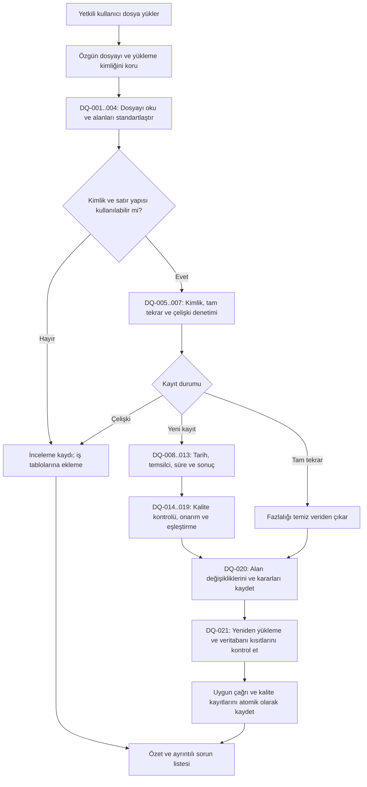
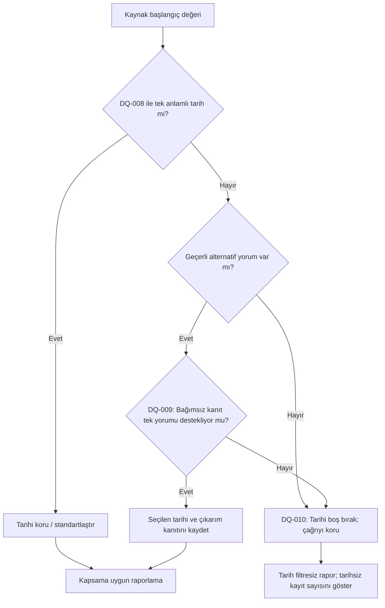
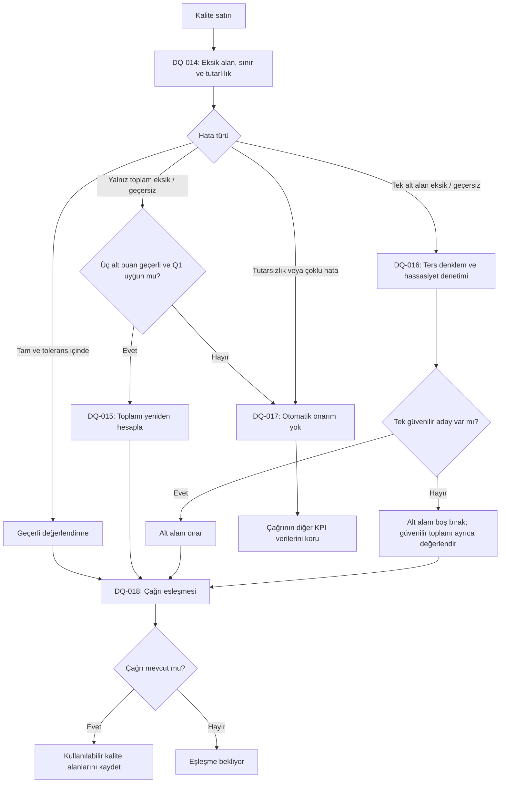

# Veri kalitesi kural kataloğu

Katalog sürümü: **1.1 — 30 Ekim 2026**. Kurallar `backend/portal/ingestion/` modüllerinde uygulanır; yükleme ekranı aynı kural kimliklerini gösterir. Kapsam ve sınırlar [uygulama durumu](#uygulama-durumu) bölümünde, çalıştırılmış kontroller [doğrulama kaydında](verification.md) belirtilir.

Her kuralın sabit bir kimliği ve kendi sürümü vardır. İşlem günlüğü, formülü açıklama metnine kopyalamak yerine örneğin `DQ-015 / v1` kaydına başvurur. Kuralın anlamı değişirse sürümü yükselir; eski işlem kayıtları eski sürüme bağlı kalır. Kimlikler yeniden numaralandırılmaz veya başka bir amaç için kullanılmaz. Önceki sürüm tanımları korunur.

## Temel ilkeler

- Özgün dosya değişmez. Temizlenmiş kayıtlar ayrı üretilir.
- Bir alanın bozukluğu, çağrının diğer geçerli alanlarını otomatik olarak geçersiz kılmaz.
- Kaynakta bulunmayan değer tahminle doldurulmaz. Kanıta dayalı çıkarım ve formülle yeniden hesaplama, kaynaktan doğrudan okunmuş değerlerden ayırt edilir.
- Sıfır, boş değer ve bilinmeyen değer birbirinin yerine kullanılmaz.
- Çağrı sayımının birimi benzersiz `call_id` değeridir. Birleştirmeler çağrı satırını çoğaltamaz.
- Rapora uygunluk alan ve kapsam bazındadır: tarihsiz çağrı tüm kayıtlar toplamına katılabilir; belirli bir günün toplamına katılamaz.

## Ana işlem akışı



Ham dosya ve inceleme kayıtları yükleme alanında saklanabilir. Temizleme tamamlanmadan raporların kullandığı `Call` ve `QualityScore` tablolarına kirli kayıt yazılmaz. Ana akıştaki sıra, önceki adımlarda veri uydurulmasına veya eşleşmeyen kaydın zorla eşleştirilmesine izin vermez.

## Kurallar

Tablodaki bütün kuralların ilk sürümü `v1`'dir. “Boş bırak” davranışı temiz veride `NULL`, Excel'de boş hücre anlamına gelir.

| Kural  | Alan / kapsam                       | Koşul ve işlem                                                                                                                                                                                        | Sonuç / rapora etkisi                                                                                                                                                                                                           |
| ------ | ----------------------------------- | ----------------------------------------------------------------------------------------------------------------------------------------------------------------------------------------------------- | ------------------------------------------------------------------------------------------------------------------------------------------------------------------------------------------------------------------------------- |
| DQ-001 | Dosya kodlaması                     | UTF-8 ve varsa BOM doğru okunur. Çözülemeyen baytlar sessizce `?` veya değiştirme karakteriyle geçiştirilmez.                                                                                         | Kodlama belirlenemiyorsa dosya açıklamalı hata ile durdurulur.                                                                                                                                                                  |
| DQ-002 | CSV yapısı                          | Dosya türüne uygun ayraç, tırnak ve sütun başlıkları doğrulanır. Kalite dosyasının noktalı virgülü desteklenir.                                                                                       | Eksik zorunlu sütun dosyayı; bozuk satır yapısı ilgili satırı incelemeye ayırır. Satırlar sessizce atlanmaz.                                                                                                                    |
| DQ-003 | Sayısal alanlar                     | Ondalık virgül, alanın biçim sözleşmesine göre Decimal değere çevrilir. `77,5` değeri `77.5` olur. Sürede kesirli değer sessizce tamsayıya yuvarlanmaz.                                               | Anlam ve hassasiyet korunur; geçersiz değer ilgili alan kuralına yönlendirilir.                                                                                                                                                 |
| DQ-004 | Metin ve adlar                      | Kenar boşlukları ve tanımlı etiket varyasyonları standartlaştırılır. Türkçe harfler korunur. Bozulmuş kodlama ancak özgün yazım tek anlamlı biçimde geri kazanılabiliyorsa onarılır.                  | Ad soyad bölünmez; aksanlar silinmez; benzer isimden kişi tahmini yapılmaz. Belirsiz onarım uygulanmaz.                                                                                                                         |
| DQ-005 | `call_id`                           | Çağrıyı tekil olarak tanımlayabilen, şemaya uygun kaynak kimliği gerekir. Kimlik uydurulmaz veya uzun değer kesilmez.                                                                                 | Eksik / kullanılamayan kimlikli kayıt iş tablolarına alınmaz; kaynağı korunur.                                                                                                                                                  |
| DQ-006 | Tam tekrar                          | Aynı `call_id` ve ayrıştırılmış kaynak alanlarının tamamı aynıysa bir örnek tutulur.                                                                                                                  | Fazlalık çağrı sayılmaz. Farklı kimlikli benzer çağrılar birleştirilmez.                                                                                                                                                        |
| DQ-007 | Aynı kimlikte çelişki               | Aynı `call_id` altında farklı içerik varsa rastgele ilk / son satır seçilmez, alanlar gelişigüzel birleştirilmez.                                                                                     | Yeni çelişkili grup incelemeye ayrılır. Veritabanında önceki kabul edilmiş kayıt varsa sessizce üzerine yazılmaz.                                                                                                               |
| DQ-008 | Açık tarih biçimleri                | Tanımlı tarih-saat biçimleri açık format listesiyle ayrıştırılır. Örnekler: `YYYY-MM-DD HH:mm:ss`, `DD.MM.YYYY HH:mm`.                                                                                | Gerçek tarih-saat değeri üretilir; geçersiz takvim günü düzeltilmiş gibi gösterilmez.                                                                                                                                           |
| DQ-009 | Belirsiz tarih biçimi               | Olası yorumlar; bağımsız kaynak dönem bilgisi ve açık biçimde okunabilen tarihlerin dağılımıyla karşılaştırılır. Otomatik onarım için tek yorumun desteklenmesi gerekir.                              | Kanıt ve seçilen yorum kaydedilir. Satır komşuluğu veya çoğunluk tek başına yeterli değildir. Dönem her dosyada Ekim varsayılmaz.                                                                                               |
| DQ-010 | Kurtarılamayan tarih                | Tarih eksik, imkânsız veya belirsiz kalıyorsa başlangıç tarihi boş bırakılır.                                                                                                                         | Diğer alanları geçerli çağrı korunur. Tarih filtresiz özetlere katılabilir; gün / tarih aralığı raporlarına katılamaz. Saat de bağımsız biçimde güvenilir değilse saatlik rapora katılmaz.                                      |
| DQ-011 | Temsilci ve takım                   | `temsilci_id` ile `agents.csv` kadrosundan ad ve takım eşleştirilir. Bu case için dosyadaki takım kullanılır.                                                                                         | Eşleşmeyen temsilcili çağrı şirket ve kampanya kapsamında korunur; herhangi bir kişiye veya takıma atanmaz. Kaptana kapsam dışı kayıt gösterilmez.                                                                              |
| DQ-012 | Süre                                | Geçerli, sıfır veya pozitif tamsayı saniye korunur. Eksik, negatif, okunamayan veya veritabanı sınırını aşan süre boş bırakılır.                                                                      | Mutlak değer veya ortalama ile doldurma yoktur. Çağrı diğer sayımlara katılabilir. Konuşma ortalaması yalnızca ulaşılan ve geçerli süreli çağrılardan hesaplanır.                                                               |
| DQ-013 | Çağrı sonucu                        | Tanımlı karşılıklar Satış, Ret, Geri ara, Ulaşılamadı sonuçlarına eşlenir. İlk üçü ulaşılmış sayılır.                                                                                                 | `???` gibi bilinmeyen sonuç boş kalır. Süreye göre sonuç tahmini yapılmaz. Çağrı toplamda kalır; bilinen sonuç kategorilerine yazılmaz.                                                                                         |
| DQ-014 | Kalite sınır ve tutarlılık kontrolü | Puanlar 0–100 aralığında kontrol edilir. Tam ve sayısal satır Q1 profiline göre karşılaştırılır. Kaynak toplam tek ondalıklı olduğunda en fazla 0.05 puan yuvarlama farkı kabul edilir.               | Alanın eksik, aralık dışı veya yalnızca tutarsız olduğu ayrı belirlenir. Tutarlı görünmesi bütün alanların kesin doğru olduğunu kanıtlamaz.                                                                                     |
| DQ-015 | Toplam kalite puanını kurtarma      | Yalnızca toplam eksik / açıkça geçersiz, üç alt puan geçerli ve Q1 profili bu kaynağa uygulanabilir ise toplam yeniden hesaplanır.                                                                    | Sonuç 0–100 aralığında olmalıdır. Kaynaktan gelmiş toplam yerine “yeniden hesaplandı” izi tutulur; ham hesap gereksiz yere bir ondalığa indirilmez.                                                                             |
| DQ-016 | Tek alt puanı kurtarma              | Hangi alt alanın eksik / geçersiz olduğu belli, diğerleri kullanılabilir ise ters denklemden aday aralığı çıkarılır. Toplamın yuvarlama belirsizliği hesaba katılır.                                  | Ancak kaynak puan hassasiyeti ve sınırlarıyla tek aday belirlenebiliyorsa onarılır. Tamsayı puan kuralı kanıt olmadan varsayılmaz. Kesin aday yoksa alt alan boş / incelemede kalır; güvenilir toplam ayrı değerlendirilebilir. |
| DQ-017 | Belirsiz kalite hatası              | Bütün alanlar aralık içinde olduğu halde formül tutmuyorsa veya birden fazla alan bozuksa denklemle otomatik alan seçimi yapılmaz.                                                                    | Güvenilirliği çözülemeyen kalite değerlendirmesi ilgili kalite hesabından ayrılır; çağrı diğer KPI'lardan atılmaz.                                                                                                              |
| DQ-018 | Eşleşmeyen kalite                   | Kalite kaydının `call_id` değeri kabul edilen çağrılarda bulunmuyorsa eşleşme bekler.                                                                                                                 | Mevcut kalite raporuna girmez. Çağrı sonradan gelince kimlik ve kalite kuralları yeniden kontrol edilir. Diğer hatalar eşleşme bekliyor durumunun arkasında gizlenmez.                                                          |
| DQ-019 | Kalitesi olmayan çağrı              | Çağrıya ait kullanılabilir değerlendirme yoksa kalite alanları boş kalır.                                                                                                                             | Sıfır puan verilmez. Kalite ortalaması yalnızca kullanılabilir değerlendirmeler üzerinden hesaplanır. Normal değerlendirme yokluğu her çağrı için hata logu üretmek zorunda değildir.                                           |
| DQ-020 | İşlem izi                           | Her değişiklik, dışlama, belirsizlik ve eşleşme sorunu kural kimliği + sürümüyle kaydedilir. Özgün dosya bir kez korunur.                                                                             | Yönetici özeti ve ayrıntı görünümü aynı işlem kayıtlarından üretilir. Değişmeyen her hücre için ayrı log yazılmaz.                                                                                                              |
| DQ-021 | Yeniden yükleme / kayıt bütünlüğü   | Aynı dosya veya çağrı yeniden geldiğinde mevcut içerik karşılaştırılır. Tam tekrar çoğaltılmaz; değişen içerik çelişki olarak değerlendirilir. Son ilişkiler ve kısıtlar kayıt öncesi kontrol edilir. | Çağrı ve kalite yazımları atomiktir. Veritabanı hatası sessizce kısmi rapor üretmez; işlem başarısızlığı kayda geçer.                                                                                                           |

## DQ-013 sürüm geçmişi

- **v1 / katalog 1.0:** Küçük harfe dönüştürülmüş etiket yalnızca `satis`, `satış`, `ret`, `geri_ara`, `geri ara`, `ulasilamadi`, `ulaşılamadı` listesiyle eşleştirilirdi. Kısmen Türkçe yazılmış `ulasılamadı` bu listede bulunmadığından boş sonuç olarak kaydedilirdi.
- **v2 / katalog 1.1:** Yalnızca sonuç etiketinde büyük/küçük harf, `İ/I/ı/i` ve `Ş/ş/s` karşılıkları standartlaştırılır. Ardından bilinen sonuç sözlüğüyle tam eşleşme aranır. `ulasılamadı`, `ulaşilamadi`, `ULAŞILAMADI` aynı `ResultId=4` değerine karşılık gelir. Temsilci/kampanya adları bu işlemden etkilenmez. Kelime benzerliğine göre tahmin yapılmaz; `???`, `ulaşıldı` ve sözlükte olmayan ifadeler boş kalır.

Yeni eşleştirmeler `DQ-013 v2` ile kaydedilir. Eski yükleme sürümü ve özgün satır değiştirilmez. Önceden boş kaydedilmiş sonuçlar için [onarım komutu](data-imports.md#mevcut-boş-çağrı-sonuçlarını-onarma) ayrı bir düzeltme izi oluşturur; eski bilinmeyen-sonuç kaydını silmeden çözüldü olarak işaretler. Diğer kuralların sürümü 1 olarak kalır.

## Alanların izlediği yollar

| Alan                             | Kural yolu                                               |
| -------------------------------- | -------------------------------------------------------- |
| Bütün kaynak alanlar             | DQ-001 → DQ-002; uygun alanlarda DQ-003 / DQ-004         |
| Çağrı kimliği ve satır bütünlüğü | DQ-005 → DQ-006 veya DQ-007 → DQ-021                     |
| Çağrı başlangıcı                 | DQ-008 → gerekirse DQ-009 → kurtarılamıyorsa DQ-010      |
| Temsilci adı ve takım            | DQ-004 → DQ-011                                          |
| Süre                             | DQ-003 → DQ-012                                          |
| Sonuç                            | DQ-004 → DQ-013                                          |
| Toplam / alt kalite puanları     | DQ-003 → DQ-014 → koşula göre DQ-015, DQ-016 veya DQ-017 |
| Kalite–çağrı ilişkisi            | DQ-018; çağrıda değerlendirme yoksa DQ-019               |
| Her değişiklik ve sorun          | DQ-020                                                   |

Kampanya, takım ve değerlendirici adları standartlaştırılmış tam adla eşleştirilir; benzerlikten kişi veya kurum tahmini yapılmaz. Aynı ada birden fazla varlık karşılık geliyorsa satır incelemeye ayrılır. Boş/geçersiz değerlendirici kaliteyi engeller. Yeni kampanya/takımın adı 12 karakterlik kimlik sözleşmesine uymuyorsa addan deterministik bir kimlik türetilir; adın kendisi korunur. Ayrıntılar: [yükleme akışı](data-imports.md).

## Tarih karar akışı



Tarih filtresi uygulanmış raporun payı ve paydası aynı kayıt kapsamını kullanır. “Tüm kayıtlar”, sisteme yüklenmiş kayıtların tamamı demektir; kuruluşun bilinmeyen geçmişinin tamamı olduğu iddia edilmez. Tarihsiz kayıtlar nedeniyle genel toplam ile günlük grafik toplamı farklıysa fark ayrıca görünür.

## Q1 kalite profili — sürüm 1

Bu profil yalnızca incelenen case kaynağındaki ilişkiye dayanır. Başka kaynaktan gelen dosyaya sessizce uygulanmaz; her yüklemede model yeniden eğitilmez.

```text
q = 0.25 * selamlama + 0.40 * ihtiyac_analizi + 0.35 * kapanis
```

Profilin kanıtı: geçerli aralıktaki 687 kaynak satırının 681'inde mutlak fark en fazla 0.05 puandır. Kalan altı satırda fark 0.20 puandır ve bu satırların çağrı eşleşmesi yoktur. Bu gözlem, katsayıların desteklenmesidir; formülle uyumsuz alanın yerini her durumda belirleme garantisi değildir.

Üç alt puan tamsayı olduğunda ağırlıklı toplam iki ondalıkla tam temsil edilebilir. Örneğin `1000` toplamı ve `77 / 73 / 63` alt puanları için DQ-015 sonucu `70.50` olur. `77.05` gibi bir sonuç saklanırken kaynak toplamın özgün yuvarlama tercihi biliniyormuş gibi davranılmaz. Hesaplarda Decimal kullanılır; rapor gösteriminde yuvarlama ayrıca tanımlanır.

Bir alt puan ters hesaplanırken kaynak toplamın bir ondalıkla gösterilmiş olması yaklaşık ±0.05 toplam belirsizliği doğurur. Örneğin selamlama için bu aralık yaklaşık ±0.20 puana genişler. Sadece merkez değeri hesaplayıp özgün puan bulundu denmez. Uç noktalardaki yuvarlama kuralı da aday denetiminin parçasıdır.



Karşı örnek: `q=44`, diğer üç puan `30` olduğunda tek yanlış alan varsayımıyla toplam `30`, selamlama `86`, ihtiyaç analizi `65` veya kapanış `70` olabilir. Hepsi farklı, geçerli bir düzeltmedir. Tek denklem hatayı her durumda konumlandıramaz; birden fazla hata birbirini dengeleyebilir.

## İşlem günlüğü ve görünüm

Detay kaydı en az şu alanları taşır:

| Alan                                              | Amaç                                                                                                           |
| ------------------------------------------------- | -------------------------------------------------------------------------------------------------------------- |
| Yükleme kimliği, dosya adı, kaynak satır numarası | Kaydı özgün girdiye bağlar.                                                                                    |
| Çağrı / kaynak kayıt kimliği                      | Hangi varlığın etkilendiğini gösterir; kimlik yoksa satır konumu kullanılır.                                   |
| Alan adı, önceki değer, sonraki değer             | Değişikliği yeniden okunabilir kılar.                                                                          |
| Kural kimliği, kural sürümü, profil sürümü        | Kararın hangi tanımla alındığını sabitler.                                                                     |
| İşlem türü ve gerekçe / kanıt                     | Doğrudan dönüşüm, çıkarım, yeniden hesaplama, boş bırakma, tekrar çıkarma veya incelemeye ayırmayı ayırt eder. |
| İşlem zamanı, yükleyen kullanıcı                  | İşlemi yapan kişiyi ve zamanı izler.                                                                           |
| Rapor etkisi                                      | Örneğin “Süre ortalamasından çıkarıldı; satış sayımında korundu”.                                              |

Bir alana birden fazla dönüşüm uygulanırsa sıra korunur. İlk özgün değer, ara dönüşüm nedeniyle kaybolmaz. Örnek kayıt: `C101199 / toplam_puan / 1000 → 70.50 / DQ-015 v1 / Q1 v1`.

Yönetici önce toplam satır, benzersiz çağrı, düzeltilen alan, etkilenen benzersiz çağrı, tekrar, bekleyen eşleşme ve inceleme sayılarını görür. Kural bazlı adetler açılabilir. Bir çağrı birden fazla kurala takılabileceğinden, kural adetlerinin toplamı “etkilenen çağrı sayısı” diye sunulmaz. Ayrıntılara rol kapsamı uygulanır.

## Uygulama durumu

Yükleme API'si ve arayüzü bu katalogla bağlandı:

1. `0004` migration'ı `Call.started_at` alanını NULL kabul edecek biçimde değiştirir ve yapılandırılmış işlem izi alanlarını ekler.
2. Özgün dosya/satır, temizlenmiş alanlar ve sıralı önce/sonra kayıtları ayrı korunur. Katalog sürümü yüklemede, kural sürümü işlem kaydında sabittir.
3. Kaptanın çağrı kapsamı, tarihten bağımsız olarak temsilcinin güncel takımını kullanır. Bilinmeyen temsilciler hiçbir kaptanın kapsamına girmez.
4. Q1 açıkça seçilir; başka dosyalara katsayı eğitimi veya otomatik profil tahmini yapılmaz. Kaynak alt puan hassasiyeti kanıtlanmadığı için DQ-016 aralığı kaydeder, tek bir sayı uydurmaz.
5. DQ-009 yalnızca kullanıcı tarafından belirtilmiş kaynak dönemi ve açık tarihler tek yorumu destekliyorsa çalışır. Bunlar yoksa belirsiz tarih NULL kalır.
6. [KPI hesaplama servisi](reporting-api.md) temiz kayıtlardan beslenir; tarih/süre/kalite eksikliği kuralları sorgularda uygulanır. Dashboard gösterimi ve Excel çıktısı henüz bağlı değildir.

Kaynak case belgeleri ve CSV dosyaları yerinde değiştirilmez. Katalogda önerilen inceleme ve log davranışları, gerçek yükleme sırasında kaynak kayıtların üzerine yazmayı gerektirmez.
