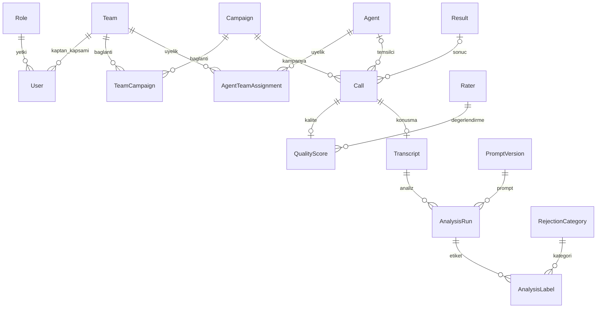

# Veritabanı tasarımı

Windows’taki `start.bat` akışı mevcut Neon PostgreSQL bağlantısını ister ve yerel ayarlardan tekrar kullanır. PostgreSQL seçimini Django’da `PGDATABASE` ve ilgili `PG*` ayarları belirler. Doğrudan Node/Django akışında bu ayarlar yoksa `.local/portal.sqlite3` kullanılır; normal Windows sihirbazı eksik Neon ayarıyla sessizce bu yola geçmez. Yeni tabloyu elle kurmak gerekmez; başlatıcı migration zincirini uygular. Bu şemanın ilk geçiş kontrolleri SQLite üzerinde yapılmıştır; tarihli doğrulama kapsamı [verification.md](verification.md) içindedir.

## Kimlikler ve alan türleri

| Kayıt / alan                                 | Tercih                                                                  |
| -------------------------------------------- | ----------------------------------------------------------------------- |
| Çağrı, temsilci, takım, kampanya kimliği     | En fazla 12 karakter; büyük İngilizce harf, rakam, `_`, `-`             |
| Rol kimliği                                  | `admin`, `manager`, `captain`; en fazla 12 karakter                     |
| Kullanıcı, üyelik, takım–kampanya bağlantısı | Otomatik artan `INT`                                                    |
| Sonuç kimliği                                | `SMALLINT`                                                              |
| Değerlendirici kimliği                       | Otomatik artan `SMALLINT`                                               |
| Çağrı süresi                                 | Saniye cinsinden `SMALLINT`; NULL veya 0–32767                          |
| Puanlar                                      | `DECIMAL(5,2)`; 0–100 kontrolü                                          |
| İşe başlama günü                             | `DATE`; bilinmiyorsa NULL                                               |
| İş zamanları                                 | PostgreSQL'de `TIMESTAMP WITHOUT TIME ZONE`; SQLite'ta tarih–saat alanı |
| Transkript ve prompt                         | `TEXT`                                                                  |

Süre için 1024 saniyelik yapay bir üst sınır yoktur. Negatif/eksik süre temizlenmiş çağrıda NULL kalır; orijinali yükleme satırında saklanır. FK alanları bağlandıkları anahtarın türünü kullanır. Tekrar eden bağımsız `code` sütunu yoktur: iş kimliği doğrudan PK'dir.

SQLite, PostgreSQL'in sabit baytlı türlerini ve kesin ondalık saklamasını aynı biçimde uygulamaz. Model/alan doğrulamaları ve veritabanı kısıtları birlikte kullanılmalıdır. Puanlar uygulamada `Decimal` olarak işlenir; ileride KPI hesaplarında yuvarlama açıkça belirlenmelidir.

## Modeller

Model dosyaları `backend/portal/models/` altında sorumluluklarına göre ayrılır. Fiziksel tablo adları Django'nun `portal_` önekini kullanır.

| Model                 | Temel alanlar ve sorumluluk                                                                                                           |
| --------------------- | ------------------------------------------------------------------------------------------------------------------------------------- |
| `Role`                | `id`, `name`; üç sabit yetki rolü                                                                                                     |
| `User`                | Tamsayı `id`, `email`, `display_name`, `role`, kaptan için `team`, `created_by`, `auth_version`, tarih alanları; Django parola hash'i |
| `Team`                | Metin `id`, `name`, aktiflik ve oluşturulma bilgileri                                                                                 |
| `Campaign`            | Metin `id`, `name`, aktiflik ve oluşturulma bilgileri                                                                                 |
| `TeamCampaign`        | `team`, `campaign`; ikili benzersizdir                                                                                                |
| `Agent`               | Metin `id`, `name` (tam ad), `start_date`, aktiflik; giriş hesabı yoktur                                                              |
| `AgentTeamAssignment` | `agent`, `team`, `valid_from`, `valid_to`, `created_by`                                                                               |
| `Result`              | Sayısal `id`, `name`, ulaşılmış sayılma bilgisi                                                                                       |
| `Call`                | `id`, `agent`, `started_at`, `duration_seconds`, `result`, `campaign`, kaynak satır                                                   |
| `Rater`               | Küçük sayısal `id`, `name`; kişi ya da ekip etiketi olabilir                                                                          |
| `QualityScore`        | PK/FK `call`, `rater`, toplam ve üç alt puan, kaynak satır                                                                            |
| `Transcript`          | PK/FK `call`, özgün `content`, SHA-256, yükleyen, zaman, kaynak satır                                                                 |
| `ImportBatch`         | Dosya türü, özgün dosya adı ve baytları, SHA-256, yükleyen, işlem durumu                                                              |
| `ImportRow`           | Yükleme, satır numarası, özgün alanlar, satır durumu                                                                                  |
| `ImportIssue`         | Satır, hata kodu, alan, açıklama, çözüm bilgileri                                                                                     |
| `RejectionCategory`   | Kategori kimliği, adı, tanımı, aktiflik; dokuz sürümlü ret kategorisi; ilk analizde kaydedilir                                        |
| `PromptVersion`       | İsim, sürüm, prompt metni, kullanılan kategori tanımlarının kopyası, hash                                                             |
| `AnalysisRun`         | Transkript, prompt, sağlayıcı/model, girdinin kopyası ve hash'i, parametreler, cevap, süre/token ölçümleri, durum                     |
| `AnalysisLabel`       | Analiz, kategori, konuşmadan kanıt, açıklama, birincil sebep işareti                                                                  |
| `AuditEvent`          | İşlemi yapan, eylem, hedef, açıkça seçilmiş ayrıntılar, zaman                                                                         |
| `LoginAttempt`        | Hash'lenmiş giriş denemesi anahtarı, sayaç, sona erme zamanı                                                                          |
| `PlanningRevision`    | Eşzamanlı plan kayıtları için sürüm sayacı                                                                                            |

Ana iş modellerine ek olarak Django kullanıcı–izin/grup ara tablolarını ve oturum tablolarını yönetir. Toplam portal tablosu sayısı bu nedenle model sayısından farklıdır.



## Tarih ve takım geçmişi

Veritabanındaki iş zamanları **Türkiye yerel saati** olarak saklanır. `LocalDateTimeField`, PostgreSQL'de timezone içermeyen timestamp oluşturur. Django uygulaması kendi tarih nesnelerinde timezone bilgisini korur; alan, yazarken Türkiye saatine dönüştürüp timezone bilgisini kaldırır, okurken tekrar ekler. Bu, farklı işletim sistemi saat dilimlerinde aynı iş saatinin korunmasını sağlar. Her iki bağlantının `TIME_ZONE` değeri `Europe/Istanbul`'dur; `USE_TZ=True` Django'nun oturum ve kimlik doğrulama davranışını korur.

Üyelik aralığı `[ValidFrom, ValidTo)` biçimindedir: başlangıç dahil, bitiş hariç. Bitişi NULL olan kayıt devam eden üyeliği belirtir. Bir temsilcinin tek açık üyeliği olabilir; açık ya da kapalı hiçbir dönem çakışamaz. Bunu model kısıtları, atomik atama servisi ve SQLite/PostgreSQL çakışma trigger'ları birlikte korur.

Planlama kaydı eski üyeliği kapatır, yenisini aynı anda başlatır. `Agent.TeamId` tutulmaz. Bu case'in kararı uyarınca kaptanın çağrı sorgusu `scoped_calls()` aracılığıyla temsilcinin **güncel takım üyeliğini** kullanır; tarihsiz çağrılar da doğru kişinin kapsamında kalır. Güncel kampanya bağlantısını tüm çağrılara erişim izni olarak kullanmaz. Bilinmeyen temsilcili çağrılar yalnızca genel yetkili sorgulara dahildir.

Kaynak CSV geçmiş takım değişim tarihleri içermiyor. Migration ve kadro yükleyici üyeliği yalnızca gözlemlendiği anda başlatır; işe başlama gününü üyelik tarihi saymaz. `agents.csv` yüklenince güncel takım atanır; önceki üyelik kaydı korunur. Case raporlarında bu güncel kadro kullanılır. Ayrıntı: [DQ-011 ve uygulama durumu](data-quality-rules.md).

## Sonuçlar ve eksik veriler

| ID  | Sonuç       | Ulaşılan çağrı sayılır mı? |
| --- | ----------- | -------------------------- |
| 1   | Satış       | Evet                       |
| 2   | Ret         | Evet                       |
| 3   | Geri ara    | Evet                       |
| 4   | Ulaşılamadı | Hayır                      |

Kaynak metinlerden sayısal sonuca eşleştirme yükleyicinin sorumluluğudur. `???` otomatik olarak ulaşılamadı sayılmaz; bilinmeyen sonuç NULL olabilir. `0004` sonrasında `Call.started_at` NULL kabul eder. DQ-010, kurtarılamayan tarihi boş bırakıp diğer kullanılabilir çağrı verilerini korur. Eşleşmeyen kalite satırı ve otomatik onarılamayan puanlar ham yükleme katmanında bekler. Kabul edilen temizleme davranışı [kural kataloğunda](data-quality-rules.md) tanımlıdır.

Bir çağrı için en fazla bir kalite kaydı ve bir transkript vardır. Kalite kaydı olmayan çağrı raporda NULL puanla yer alır, sıfır verilmez. Alt puanlar eksikse NULL kalabilir. DQ-015, Q1 profilinin seçildiği kaynakta yalnız toplam puan eksik veya açıkça geçersiz ve üç alt puan geçerliyse toplamı yeniden hesaplar. DQ-016 ve DQ-017, ters hesaplamanın ve belirsiz hataların sınırlarını belirler. Bu kararlar alan bazındaki işlem günlüğüne yazılır.

## Transkript ve LLM kayıtları

Transkript tek ham metin olarak korunur; `TranscriptTurns` tablosu yoktur. `rejection_analysis/transcripts.py` konuşmacı/sıra bilgisini görünüm için kodda üretir. OpenAI entegrasyonu ve kayıtlı sonuç ekranı [ret analizi modülünde](rejection-analysis.md) uygulanmıştır.

Dokuz kategori ve sürümlü prompt, ilk analiz isteğinde kayıt altına alınır. Aynı transkript farklı sağlayıcı/model/prompt ile tekrar değerlendirilebilir. Bir analiz aynı kategoriye iki kez bağlanamaz; en fazla bir birincil sebep vardır. Rapor için transkript başına en fazla bir tamamlanmış analiz seçilebilir. Başarısız çalışma seçilemez.

Analiz girdisi ve kategori tanımlarının sürüm kopyaları bilinçli olarak korunur: transkript ya da kategori tanımı değiştiğinde geçmişte modelin ne gördüğünü açıklayabilmek için gerekir. Hash tek başına eski metni geri getiremez. API anahtarları bu tablolara yazılmaz. Tamamlanan analizler ve kullanılan prompt sürümleri daha sonraki iş akışında değiştirilmeyip yeni sürüm/çalışma oluşturulmalıdır.

## Geçiş ve yedek

Başlatıcı artık `upgrade_database` komutunu çağırır. Bekleyen migration varsa mevcut SQLite veritabanı önce `.local/backups/` altına tutarlı biçimde yedeklenir. Yedek bütünlüğü doğrulanmadan geçiş başlamaz. Bu özel klasör Git'e dahil değildir.

```powershell
.\.venv\Scripts\python.exe backend/manage.py upgrade_database
```

`0001_initial` değiştirilmedi. `0002` eski portal kayıtlarını işlem içinde okuyup UUID → tamsayı/metin anahtar eşleştirmesiyle yeniden kurar. Hesaplar, parola hash'leri, ilişkiler, izin üyelikleri ve işlem günlüğü korunur. Eski kimlik eşleştirmeleri bir migration audit kaydında tutulur. 12 karaktere sığmayan eski iş kodu varsa kimlik üretilir ve eski kod bu eşleştirmede korunur; sessizce kesilmez. Eski audit hedefleri/kopyaları geçmişin özgün kimliklerini korur, eşleştirme kaydıyla izlenebilir.

Eski oturumlar kapatılır ve yetki sürümü artırılır. Kullanıcı aynı e-posta ve şifreyle yeniden giriş yapar. Eski graph konumları kimlik değişikliği nedeniyle yeniden yerleşebilir. `0003`, üyelik çakışmalarını engelleyen trigger'ları ekler.

Kimlik geçişi otomatik geri migration desteklemez. Geri dönüş gerekirse uygulama durdurulur, geçiş öncesi veritabanı yedeği **eski kod sürümüyle birlikte** kullanılır. PostgreSQL için işlem öncesi standart veritabanı yedeği ayrıca alınmalıdır; yerel komutun dosya yedeği yalnızca SQLite içindir.

## Bu adımın sınırı

Veritabanı şeması, mevcut hesap/planlama kodu ve CSV/TXT yükleyici bağlanmıştır. `0004` migration'ı tarihsiz çağrılar, yükleme özetleri, temizlenmiş satır alanları ve sürümlü işlem izini ekler. KPI hesapları, formüllü Excel çıktısı ve OpenAI ret analizi bu şemaya bağlıdır. Çalıştırılan kontroller ve sınırları [doğrulama kaydında](verification.md) ayrı belirtilir. Case dosyaları değiştirilmez veya otomatik olarak içeri aktarılmaz; yetkili kullanıcı yükleme alanından seçer.
